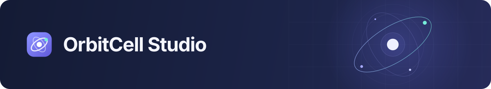
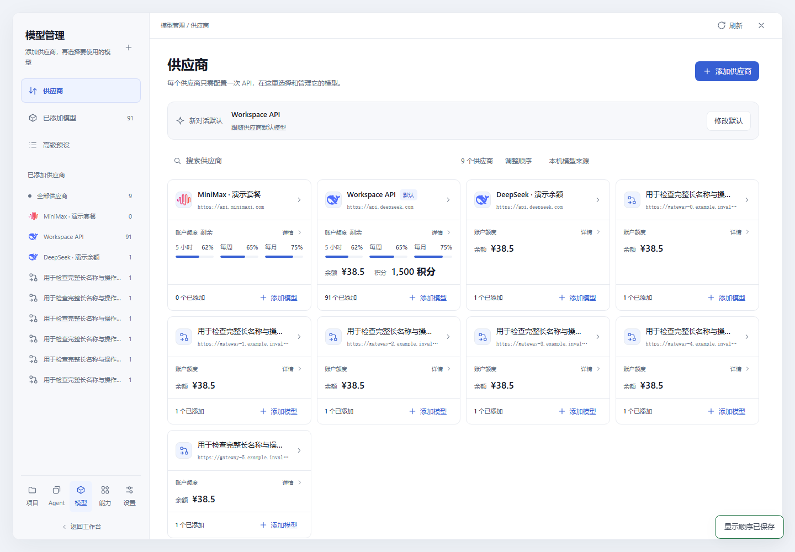
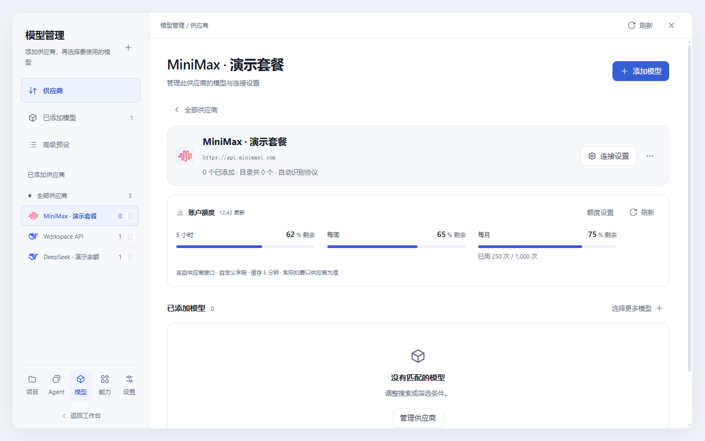
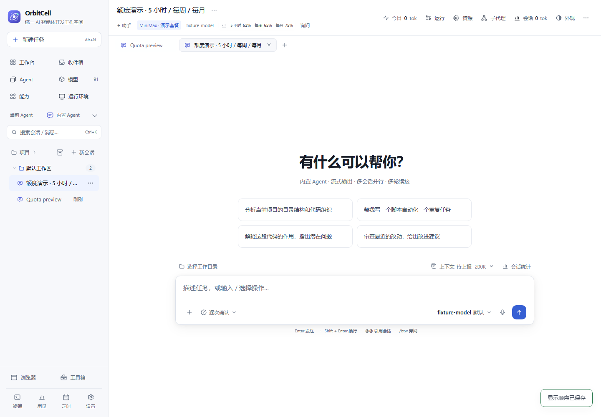
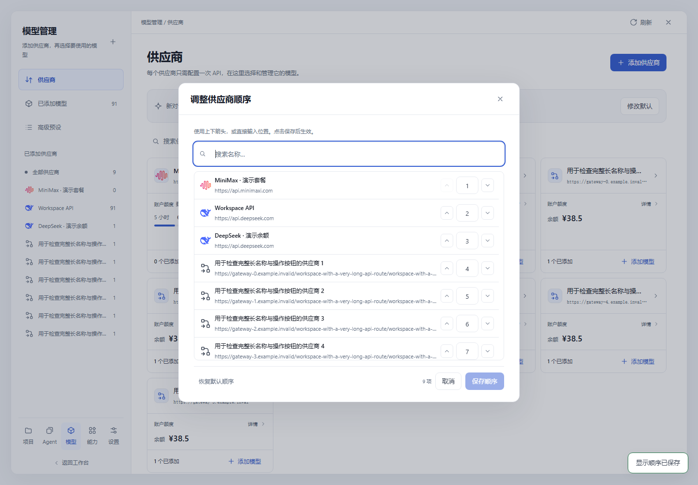

<div align="center">



<p><strong>AI Agent Development Workspace</strong></p>

<p><a href="README.md">English</a> · <a href="README.zh-CN.md">简体中文</a></p>

<p>
  
  
  
  
</p>

<p><a href="#quick-start">Quick start</a> &nbsp;·&nbsp; <a href="#workspace">Workspace</a> &nbsp;·&nbsp; <a href="#make-it-yours">Customization</a> &nbsp;·&nbsp; <a href="#documentation">Documentation</a></p>

</div>

**OrbitCell Studio brings Agents, models, tools and development workflows into one local workspace.** Choose an executor, connect your providers, and move from a conversation to files, Git, terminals and remote projects without switching interfaces.

Agents keep their own runtimes and supported controls. OrbitCell organizes the connections, project context and everyday development work around them.

<p align="center">
  <a href="docs/assets/orbitcell-agents.png"></a>
  <sub>One place for Agent settings, versions, models and environments. Screenshots use isolated demo data.</sub>
</p>

## Workspace

<table>
<tr>
<td width="50%" valign="top">
<h3>01 · Agent workspace</h3>
<p>Choose an Agent and start a conversation. See discovered versions and status, save defaults for each environment, and return to recent sessions.</p>
</td>
<td width="50%" valign="top">
<h3>02 · Providers &amp; models</h3>
<p>Configure an API once, choose models in bulk, and add more from the same provider later. Compatible Agents share connections, with exceptions when needed.</p>
</td>
</tr>
<tr>
<td valign="top">
<h3>03 · Conversations &amp; context</h3>
<p>Keep tasks tied to a project directory. Use supported permission modes, a reasoning slider, attachments and a timeline of tool activity and file changes.</p>
</td>
<td valign="top">
<h3>04 · Development tools</h3>
<p>Read and edit files, inspect diffs, work with Git and PRs, open durable terminals, and use a docked browser alongside the conversation.</p>
</td>
</tr>
<tr>
<td valign="top">
<h3>05 · Local, WSL &amp; SSH</h3>
<p>Manage project environments and run supported Agents and workspace operations on the selected target. Keep each computer's configuration separate.</p>
</td>
<td valign="top">
<h3>06 · Tools &amp; workflows</h3>
<p>Manage skills, MCP connections and assistants. Reuse task templates, schedule work, and inspect token usage, account balances and periodic allowances.</p>
</td>
</tr>
</table>

<details>
<summary><strong>Explore provider and quota views</strong></summary>

Configure a provider once, then manage its models and account information in that provider's page. Cards can show balances, credits and independent 5-hour, weekly and monthly allowances together.

<p><a href="docs/assets/orbitcell-quota-cards.png"></a></p>
<p><a href="docs/assets/orbitcell-quota-detail.png"></a></p>
<p><a href="docs/assets/orbitcell-quota-chat.png"></a></p>

Readings depend on the provider's API and account permissions. Missing data stays unknown; upstream accounts behind a gateway are not combined into one balance. [Quota sources and custom mappings →](docs/provider-quotas.md)

</details>

## Quick start

Install **[Node.js ≥ 22.19.0](https://nodejs.org/)**, then run:

```bash
git clone https://github.com/1181110317/orbitcell-studio.git
cd orbitcell-studio
npm install
npm start
```

Open **[127.0.0.1:7261](http://127.0.0.1:7261)**. No frontend build or external database service is required.

On Windows, you can also double-click **`start-server.cmd`** after installing dependencies. It checks the runtime, waits for readiness and writes a server log. The default listener is local to your computer; see [deployment](docs/deployment.md) for LAN access, reverse proxies and services.

### Your first conversation

1. **Connect your models.** Open **Models → Providers → Add provider**, enter the API address and key, then choose the models you want. If the provider does not return a catalog, enter model IDs manually. Native-only Agents use their own connection and authentication.
2. **Set your Agent defaults.** Open **Agent**, select an executor and environment, and configure its supported model, reasoning and permission choices. Local discovery reads available versions automatically.
3. **Start a task.** Click **New task** or **Start conversation**, choose the Agent, environment and working directory, then send your message. Updated defaults apply to new conversations; existing conversations keep their settings.

Use an installed Agent CLI, a configured ACP adapter, or the built-in engine with a compatible provider. Available models, permission modes and effort levels follow the selected integration's actual capabilities.

## Make it yours

<a id="arrange-your-workspace"></a>

<details>
<summary><strong>Set display positions</strong> · up/down controls and position numbers</summary>

Click **Adjust order** above an Agent, provider, model, project or tool list, or in the new-task chooser. Search for an entry, move it up/down or enter a position, then click **Save order**. **Cancel** keeps the saved order; **Restore default order** resets the draft. Categories remain grouped.

<p><a href="docs/assets/orbitcell-order-settings.png"></a></p>

Agent order is saved in workspace configuration and shared across entry points. Other card orders are saved in the current browser. Display ordering does not change enabled Agents, task settings or running work.

</details>

<details>
<summary><strong>Personalize each Agent</strong> · defaults, appearance and reading preferences</summary>

Save model, reasoning and permission defaults separately for each Agent and environment. Customize provider icons with an upload, and adjust per-Agent page preferences such as content width, tool expansion, output following and the send shortcut.

Page preferences are stored in the current browser for that Agent. [Agent configuration and page preferences →](docs/agent-management.md)

</details>

<details>
<summary><strong>Bring in conversation history</strong> · preview, select and import</summary>

Open **Agent settings → Session import** to scan a source or preview supported export files. Search the results, import selected conversations or import all remaining records. Imports add OrbitCell history without modifying source files; native resumability depends on the format and trusted source location.

[Import formats and behavior →](docs/agent-management.md#native-modes-page-preferences-and-session-import)

</details>

## Documentation

| Get started | Configure your workspace | Develop &amp; maintain |
| --- | --- | --- |
| [Deployment](docs/deployment.md) | [Agent settings](docs/agent-management.md) | [Architecture](docs/architecture.md) |
| [Configuration](docs/configuration.md) | [Models & management centers](docs/management-centers.md) | [Interface design](docs/interface-design.md) |
| [Feature reference](docs/features.md) | [Balances & quotas](docs/provider-quotas.md) | [Testing](docs/testing.md) |
| [Troubleshooting](docs/troubleshooting.md) | [Product identity](docs/branding.md) | [Changelog](CHANGELOG.md) |

[Full documentation index →](docs/README.md) · [Report an issue →](https://github.com/1181110317/orbitcell-studio/issues)

## Development

OrbitCell is actively developed with Windows as its primary platform. The browser frontend uses plain JavaScript; the server runs on Node.js. Runtime data is stored in `data/` by default, with JSON as the source of truth and SQLite as a rebuildable index. Set `ORBITCELL_DATA_DIR` to use another location.

```bash
npm test                     # Registered test suite
node test/doc-lint.js         # Documentation consistency
npm run test:models          # Focused model checks
npm run test:agents          # Focused Agent checks
```

The registered suite contains 99 scripts covering logic, APIs, protocols, persistence and browser regressions. Default tests use isolated data and do not validate every real provider account, SSH host or third-party CLI version. [Coverage and focused commands →](docs/testing.md)

<details>
<summary>Appearance themes and installation compatibility</summary>

Appearance includes 11 themes: `studio`, `paper`, `aionui`, `cottage`, `forest`, `ocean`, `sakura`, `ink`, `graphite`, `aurora`, `dusk`. The Studio theme provides the light interface shown in the previews.

New installations use the OrbitCell name and `ORBITCELL_` environment variables. Existing `AGENTHUB_` variables and stored data remain compatible. See [product identity](docs/branding.md) for the naming and compatibility details.

</details>

## License

ISC. Bundled third-party notices are listed in [THIRD-PARTY-LICENSES.md](THIRD-PARTY-LICENSES.md).
