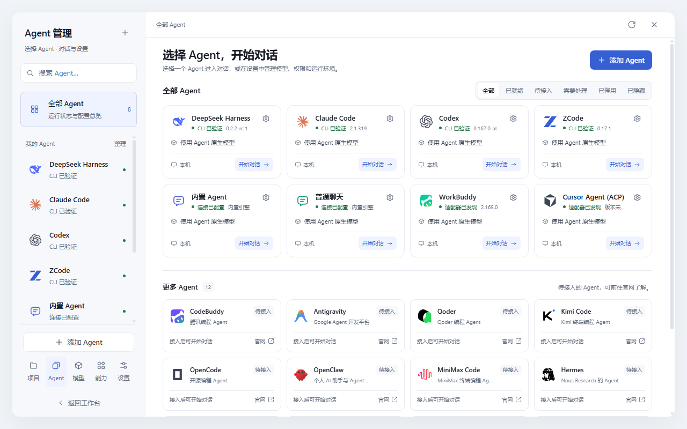
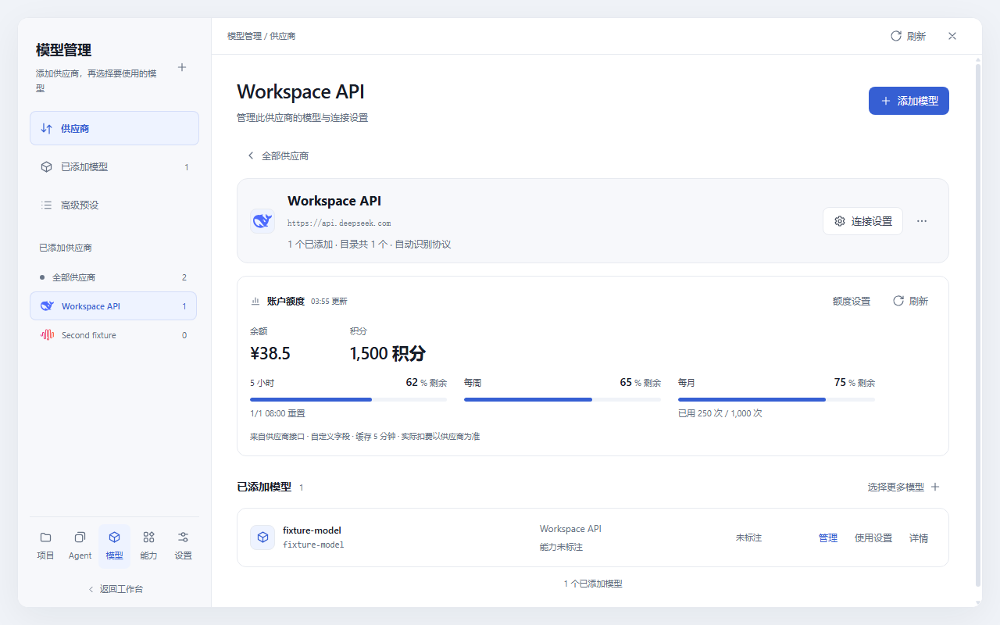

<div align="center">


<h1>OrbitCell Studio</h1>

<p><strong>AI Agent Development Workspace</strong><br>统一 AI 智能体开发工作空间</p>
<p>One Orbit. Infinite Possibilities.</p>
<p>Unify Agents, Models, Tools and Workflows.</p>

<p>Claude Code · Codex · ZCode · DeepSeek Harness · Gemini CLI · OpenCode · Built-in Agent · Custom</p>

<p>
  <a href="https://github.com/1181110317/orbitcell-studio"></a>
  
  
  
</p>

</div>

<p align="center">
  <a href="docs/assets/orbitcell-agents.png"></a>
</p>

<p align="center">
  <sub>Agents, models and development workflows in one workspace. Preview uses an isolated dataset.</sub>
</p>

OrbitCell Studio is an AI Agent management, model management and development collaboration platform. It brings coding agents, providers, tools and workflows into one local workspace. Each agent keeps its native session protocol; OrbitCell adds shared model routing, a conversation timeline, workspace tools, Git/PR flows, terminals, remote hosts, schedules and token accounting. No cloud account, no external database, and no front-end build step.

## What's new

- **Compact Agent workspace** — aligned settings, real brand icons, detected versions, native permission modes, per-Agent page preferences and selective conversation import. Catalog placeholders are clearly marked as not connected.
- **Provider-first model management** — configure a provider once, then choose its models in bulk. Compatible Agents share connections; exceptions stay with the Agent.
- **Balances and allowances** — provider cards, account details and the conversation header share one quota view. Supported APIs report balances, credits and timed allowances with resets; custom JSON mappings support other read-only quota APIs. Missing readings stay unknown.
- **Reasoning slider** — choose only the effort levels declared by the current model or Agent, with keyboard and touch support.
- **OrbitCell branding** — product name, repository, documentation and launcher are aligned. Existing installations keep their stored data and integrations.

**Agent management is now a first-class workspace.** Every executor, computer and default lives in one place.

- **Agent / Models / Environments** — separate pages for executor configuration, shared model connections and the same Agent across local, WSL and SSH targets.
- **Per-computer defaults** — default provider, model, reasoning, permissions and workspace are stored per Agent and environment; existing sessions keep their own settings.
- **On-demand diagnostics** — check a CLI, version and capabilities without launching a turn; disabled Agents stay out of new-task choices.
- **Studio theme** — a restrained light palette with the new shared interface system, while the existing themes remain available.

<p align="center">
  <a href="docs/assets/orbitcell-providers.png"></a>
</p>

<p align="center">
  <sub>Provider quota preview: balances, credits and independent usage windows. Values are isolated examples.</sub>
</p>

## Contents

| Start here | What's inside |
| --- | --- |
| ⚡ [Quick start](#quick-start) | Three commands to a local instance |
| 🚀 [Deployment guide](docs/deployment.md) | Local install, Windows launcher, LAN/phone access, reverse proxy, accounts, backups, upgrades and service examples |
| ✨ [Feature reference](docs/features.md) | Every capability: agents, chat timeline, models, usage, workspace, Git/PR, terminals, remote, automation and security |
| ⚙️ [Configuration](docs/configuration.md) | Environment variables, data directory, agent CLI setup, provider setup and access control |
| 🧭 [Agent management](docs/agent-management.md) | Per-computer Agent defaults, shared models, diagnostics, task creation and the Studio theme |
| 🧩 [Management centers](docs/management-centers.md) | Model catalog, shared API connections, global presets, skills, MCP servers, assistants and settings |
| 🎨 [Interface design](docs/interface-design.md) | Shared typography, controls, icons and responsive surfaces across every built-in workspace |
| 💳 [Provider quotas](docs/provider-quotas.md) | Balances, credits, timed allowances and custom read-only quota APIs |
| 🪐 [Product identity](docs/branding.md) | OrbitCell Studio names, positioning and installation compatibility |
| 🏗 [Architecture](docs/architecture.md) | Browser/server split, agent adapters, event model, storage layers and directory layout |
| 🧪 [Testing](docs/testing.md) | Test suite, focused commands, browser checks and coverage boundaries |
| 🩺 [Troubleshooting](docs/troubleshooting.md) | Port conflicts, missing CLIs, browser/docked-page issues, proxy problems, data recovery and common errors |

A standalone documentation index is also available at [docs/README.md](docs/README.md).

## Quick start

**Requires [Node.js](https://nodejs.org/) ≥ 22.19.0** and at least one agent CLI — or use the built-in agent with an Anthropic/OpenAI-compatible provider.

```bash
git clone https://github.com/1181110317/orbitcell-studio.git
cd orbitcell-studio
npm install
npm start
```

Open **http://127.0.0.1:7261**. The server listens on loopback by default.

On Windows, double-click **`start-server.cmd`** for a launcher with runtime checks, readiness output and a log file. For LAN / phone access, reverse-proxy setups, service managers and backups, see the [deployment guide](docs/deployment.md).

## Feature highlights

- **Every agent, one window** — Claude Code, Codex, ZCode, DeepSeek Harness, Gemini CLI, OpenCode, custom CLI/ACP agents, a built-in agent and a ChatGPT-style chat mode share one UI and one project list.
- **Agent management** — a catalog with pinning, ordering, status filters and enable/disable controls; environment tiles, shared model defaults, recent sessions and supported per-Agent tool settings. Local, WSL and SSH defaults remain separate; diagnostics run on demand. Project conversations include all agents unless explicitly filtered.
- **Native bridges, not screen scraping** — Claude speaks `--input-format stream-json`, Codex and ZCode use their official `app-server` protocols, and DeepSeek Harness uses `dsh headless --json`. Permissions, questions, model choice and usage events flow both ways.
- **A model center, not a dropdown** — search context, vision, reasoning and routing metadata; assign models per agent; save reusable profiles; connect Magpie or any Anthropic/OpenAI-compatible API.
- **A workspace, not just a chat box** — browse and edit files, preview diffs, inspect Git changes, create commits and PRs, run durable terminals and monitor CPU/GPU/network usage without leaving the conversation.
- **Remote and WSL first-class** — manage SSH hosts, stream remote sessions, preview images over SSH, run target-side file operations and share the same workflow across local, WSL and remote projects.
- **Local-first and inspectable** — JSON is authoritative, SQLite is a rebuildable index, dedicated secret stores are encrypted at rest, and optional WebUI accounts add CSRF protection and login rate limits.

## Supported agents

| Agent | Runtime | Requires |
| --- | --- | --- |
| **Claude Code** | Native `claude` stream-json bridge | `claude` CLI on the local machine, WSL or SSH target |
| **Codex** | Native `codex app-server --stdio` | `codex` CLI on the target |
| **ZCode** | Official `app-server` protocol | ZCode with `app-server` support |
| **DeepSeek Harness** | `dsh headless --json -` | `dsh` CLI; keeps its own profile |
| **Gemini CLI** | Raw CLI stream adapter | `gemini` CLI |
| **OpenCode** | Raw CLI stream adapter | `opencode` CLI |
| **Built-in Agent** | Local engine, no CLI | Nothing extra; configure an Anthropic/OpenAI-compatible provider |
| **Custom / ACP** | Command template or ACP discovery | Any CLI that speaks the selected protocol |

Details for each adapter, including WSL/SSH notes and capability limits, are in the [feature reference](docs/features.md#agents--sessions).

## Project status

OrbitCell is actively developed and Windows-first. The registered test suite contains 99 scripts covering syntax, logic, isolated API, protocols, durability and browser regressions. External provider accounts, real SSH hosts and every third-party CLI are not exercised by the default suite; use the [testing guide](docs/testing.md) for the exact scope. The application stores runtime data locally; there is no built-in cloud sync or multi-user cloud service.

Appearance includes 11 themes: `studio`, `paper`, `aionui`, `cottage`, `forest`, `ocean`, `sakura`, `ink`, `graphite`, `aurora`, `dusk`. Studio is the clean demo style; existing theme preferences remain available.

## License

ISC. See [THIRD-PARTY-LICENSES.md](THIRD-PARTY-LICENSES.md) for bundled third-party notices.
