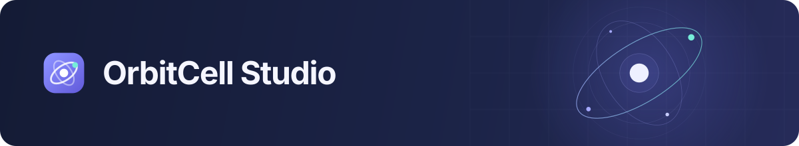
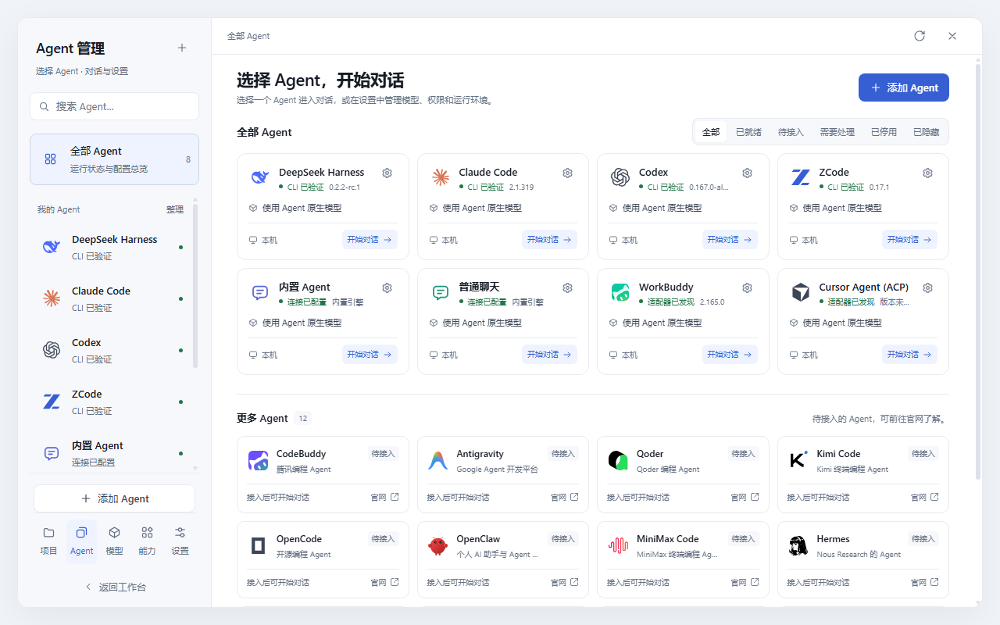
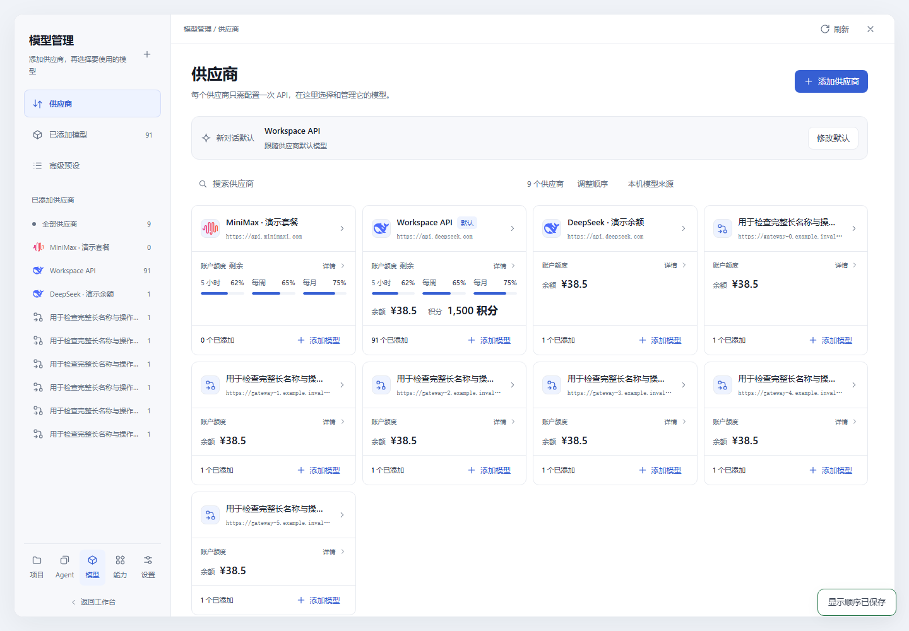
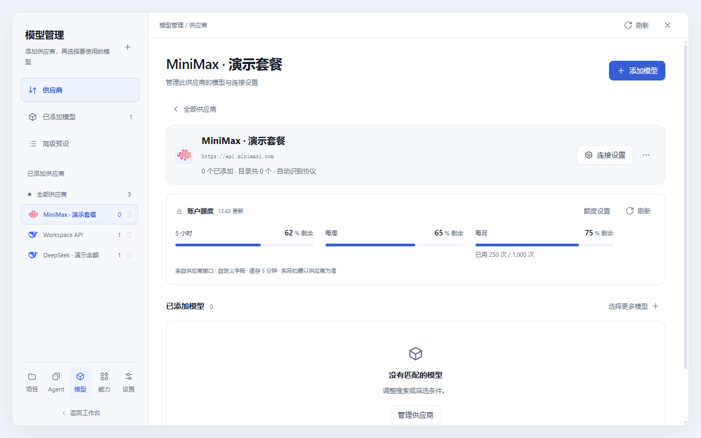
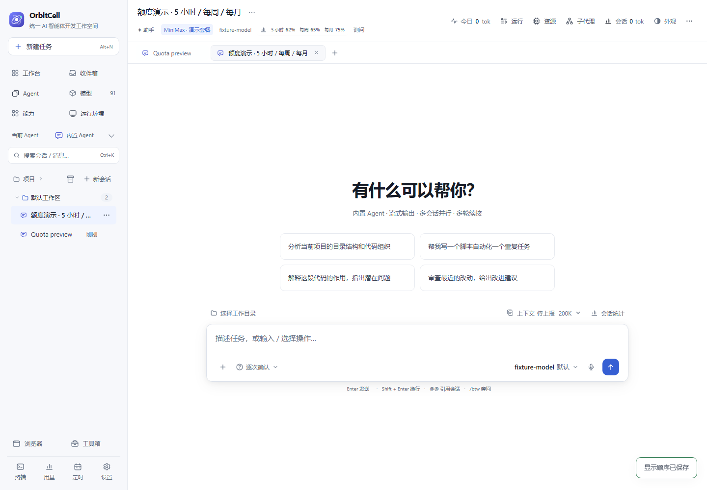
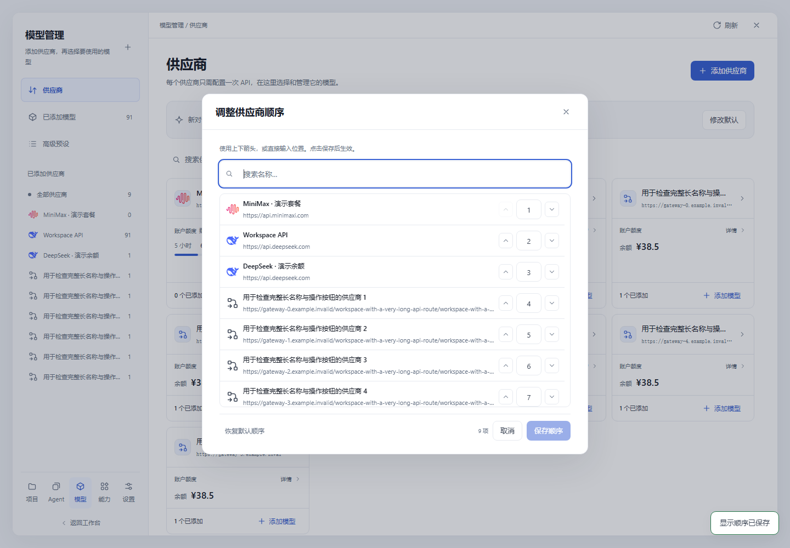

<div align="center">



<p><strong>统一 AI 智能体开发工作空间</strong></p>

<p><a href="README.md">English</a> · <a href="README.zh-CN.md">简体中文</a></p>

<p>
  
  
  
  
</p>

<p><a href="#快速开始">快速开始</a> &nbsp;·&nbsp; <a href="#工作空间">核心能力</a> &nbsp;·&nbsp; <a href="#按你的方式工作">个性设置</a> &nbsp;·&nbsp; <a href="#文档导航">文档导航</a></p>

</div>

**OrbitCell Studio 将 Agent、模型、工具与开发流程汇集到同一个本地工作空间。** 选择执行器、连接模型供应商，从对话进入文件、Git、终端和远程项目，在同一套界面中完成开发工作。

各个 Agent 保留自己的执行方式和实际支持的配置；OrbitCell 负责组织连接、项目上下文和日常开发工具。

<p align="center">
  <a href="docs/assets/orbitcell-agents.png"></a>
  <sub>在一处管理 Agent 设置、版本、模型与环境。所有截图均使用隔离的演示数据。</sub>
</p>

## 工作空间

<table>
<tr>
<td width="50%" valign="top">
<h3>01 · Agent 工作台</h3>
<p>选择 Agent，开始对话。查看检测到的版本和状态，按运行环境保存默认设置，随时回到最近的会话。</p>
</td>
<td width="50%" valign="top">
<h3>02 · 供应商与模型</h3>
<p>API 配置一次，模型批量选择；以后在同一供应商页面继续添加。兼容 Agent 默认共享连接，需要时单独配置例外。</p>
</td>
</tr>
<tr>
<td valign="top">
<h3>03 · 对话与上下文</h3>
<p>任务与项目目录关联，按能力选择权限模式与推理档位。支持附件输入，并在时间线中查看工具调用和文件变更。</p>
</td>
<td valign="top">
<h3>04 · 开发工具</h3>
<p>浏览与编辑文件、检查差异、处理 Git 和 PR、运行可恢复终端，在对话旁使用内嵌浏览器。</p>
</td>
</tr>
<tr>
<td valign="top">
<h3>05 · 本机、WSL 与 SSH</h3>
<p>管理项目的运行环境，在选定目标上运行受支持的 Agent 和工作区操作，每台电脑保留独立配置。</p>
</td>
<td valign="top">
<h3>06 · 工具与工作流</h3>
<p>集中管理技能、MCP 连接与助手，复用任务模板、安排定时任务，查看 Token 用量、账户余额和周期额度。</p>
</td>
</tr>
</table>

<details>
<summary><strong>展开查看供应商与额度界面</strong></summary>

添加供应商后，在它的管理页面继续选择模型、查看账户信息。卡片可以同时显示余额、积分以及独立的 5 小时、每周、每月额度。

<p><a href="docs/assets/orbitcell-quota-cards.png"></a></p>
<p><a href="docs/assets/orbitcell-quota-detail.png"></a></p>
<p><a href="docs/assets/orbitcell-quota-chat.png"></a></p>

数据取决于供应商接口和账户权限。缺失数据保持未知，聚合网关背后的不同账户也不会合并成一个余额。[额度来源与自定义查询 →](docs/provider-quotas.md)

</details>

## 快速开始

安装 **[Node.js ≥ 22.19.0](https://nodejs.org/)**，然后执行：

```bash
git clone https://github.com/1181110317/orbitcell-studio.git
cd orbitcell-studio
npm install
npm start
```

打开 **[127.0.0.1:7261](http://127.0.0.1:7261)**。无需构建前端或安装外部数据库服务。

Windows 安装依赖后，也可以双击 **`start-server.cmd`**。启动器会检查运行环境、等待服务就绪并记录日志。默认仅监听本机；局域网访问、反向代理和服务部署见[部署指南](docs/deployment.md)。

### 开始第一次对话

1. **连接模型**：进入“模型 → 供应商 → 添加供应商”，填写 API 地址和密钥，勾选需要的模型。供应商不返回目录时，可以手动填写模型 ID。使用原生连接的 Agent 沿用自己的连接和认证。
2. **设置 Agent 默认值**：进入“Agent”，选择执行器和运行环境，配置它实际支持的模型、推理与权限选项。本机发现过程会自动读取可用版本。
3. **开始任务**：点击“新建任务”或“开始对话”，选择 Agent、环境和工作目录，然后发送消息。更新后的默认值用于新会话，已有会话保留自己的设置。

可以使用已安装的 Agent CLI、已配置的 ACP 适配器，或为内置引擎连接兼容供应商。模型、权限模式和推理档位以所选接入实际提供的能力为准。

## 按你的方式工作

<a id="调整工作空间的显示顺序"></a>

<details>
<summary><strong>调整展示位置</strong> · 上下移动，或直接填写位置</summary>

在 Agent、供应商、模型、项目、工具列表上方，或新建任务窗口中，点击“调整顺序”。搜索条目，上移、下移或填写位置，最后点击“保存顺序”。“取消”保留已保存的顺序，“恢复默认顺序”重置当前草稿；不同分类保持分组。

<p><a href="docs/assets/orbitcell-order-settings.png"></a></p>

Agent 顺序保存在工作台配置中，各入口共用；其他卡片顺序保存在当前浏览器。调整展示位置不会改变 Agent 启用状态、任务设置或正在运行的工作。

</details>

<details>
<summary><strong>为 Agent 单独设置偏好</strong> · 默认值、外观与阅读方式</summary>

模型、推理与权限默认值按 Agent 和运行环境分别保存。供应商图标支持上传；每个 Agent 可以单独调整内容宽度、工具展开方式、输出跟随和发送快捷键等页面偏好。

页面偏好保存在当前浏览器中，按 Agent 区分。[Agent 配置与页面偏好 →](docs/agent-management.md)

</details>

<details>
<summary><strong>带上原来的对话记录</strong> · 预览、选择与批量导入</summary>

进入“Agent 设置 → 会话导入”，扫描来源目录或预览支持的导出文件。可以搜索结果、导入选中的会话，或导入全部剩余记录。导入会创建 OrbitCell 历史记录，不修改源文件；能否原生续接取决于格式和可信来源位置。

[导入格式与行为说明 →](docs/agent-management.md#native-modes-page-preferences-and-session-import)

</details>

## 文档导航

| 安装与使用 | 配置工作空间 | 开发与维护 |
| --- | --- | --- |
| [部署指南](docs/deployment.md) | [Agent 设置](docs/agent-management.md) | [架构说明](docs/architecture.md) |
| [配置说明](docs/configuration.md) | [模型与管理中心](docs/management-centers.md) | [界面设计](docs/interface-design.md) |
| [功能参考](docs/features.md) | [余额与额度](docs/provider-quotas.md) | [测试说明](docs/testing.md) |
| [常见问题](docs/troubleshooting.md) | [产品名称](docs/branding.md) | [更新记录](CHANGELOG.md) |

[完整文档索引 →](docs/README.md) · [反馈问题 →](https://github.com/1181110317/orbitcell-studio/issues)

部分深入文档目前为英文。

## 开发与项目状态

OrbitCell 持续开发中，优先支持 Windows。浏览器前端使用原生 JavaScript，服务端运行在 Node.js 上。运行数据默认保存在 `data/`，JSON 为主要存储，SQLite 是可重建的索引；可通过 `ORBITCELL_DATA_DIR` 指定其他位置。

```bash
npm test                     # 注册测试集
node test/doc-lint.js         # 文档一致性检查
npm run test:models          # 模型相关检查
npm run test:agents          # Agent 相关检查
```

注册测试集包含 99 个脚本，覆盖逻辑、API、协议、持久化和浏览器回归。默认测试使用隔离数据，不验证每个真实供应商账户、SSH 主机和第三方 CLI 版本。[测试范围与专项命令 →](docs/testing.md)

<details>
<summary>界面主题与安装兼容</summary>

界面提供 11 套主题：`studio`、`paper`、`aionui`、`cottage`、`forest`、`ocean`、`sakura`、`ink`、`graphite`、`aurora`、`dusk`。截图中的浅色界面使用 Studio 主题。

新安装使用 OrbitCell 名称和 `ORBITCELL_` 环境变量，已有 `AGENTHUB_` 变量和历史数据继续兼容，详见[产品名称与兼容说明](docs/branding.md)。

</details>

## 许可证

ISC。随附的第三方资源与许可声明见 [THIRD-PARTY-LICENSES.md](THIRD-PARTY-LICENSES.md)。
